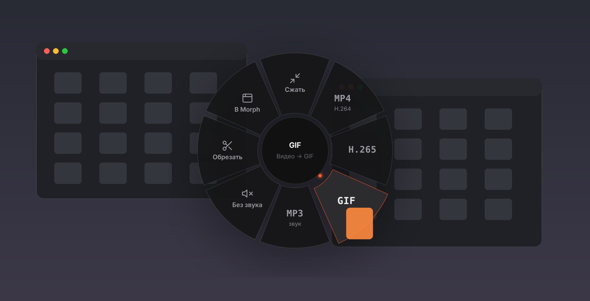
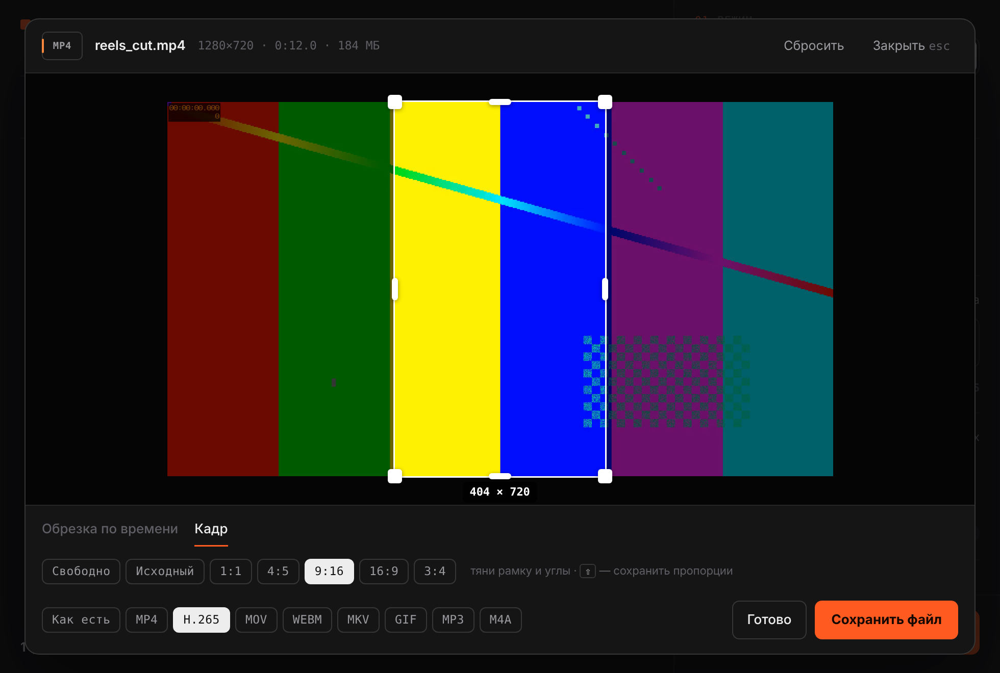

<div align="center">


# Morph

**Конвертер и сжатие любых файлов для macOS.**
Перетащил — выбрал формат — готово. Без облаков, без подписок, всё локально.

[](https://github.com/nyartny-ops/MorphConvertor/actions/workflows/ci.yml)
[](https://github.com/nyartny-ops/MorphConvertor/releases/latest)


<br>

<a href="https://github.com/nyartny-ops/MorphConvertor/releases/latest/download/Morph.dmg"></a>

<sub>бесплатно · без регистрации · работает офлайн</sub>

или одной командой в Терминале:

```bash
curl -fsSL https://raw.githubusercontent.com/nyartny-ops/MorphConvertor/main/install.sh | bash
```

<br><br>


</div>

## Что умеет



**Быстрое меню.** Тащишь файл откуда угодно — из Finder, с рабочего стола, из почты — и зажимаешь <kbd>⇧</kbd> или <kbd>⌥</kbd>: вокруг курсора раскрывается меню действий под этот тип файла. Отпустил на нужный сектор — Morph сделает всё в фоне и пришлёт уведомление. Окно открывать не нужно.

| | Действия в меню | Всё, что умеет в окне |
|---|---|---|
| **Видео** — MP4, MOV, MKV, WEBM, AVI… | Сжать · MP4 · H.265 · GIF · MP3 · Без звука · Обрезать | обрезка по времени, кадр 9:16 / 1:1 / 4:5, MP4 · H.265 · MOV · WEBM · MKV · GIF · MP3/M4A · кадр |
| **Картинки** — JPG, PNG, HEIC, WEBP, TIFF, PSD, RAW | Сжать · JPG · PNG · WEBP · PDF · Кадр | кадрирование с пропорциями, JPG · PNG · WEBP · HEIC · TIFF · GIF · PDF |
| **GIF** | Сжать · MP4 · WEBM · WEBP · Обрезать | палитра, частота кадров, размер, lossy (с gifsicle) |
| **Аудио** — MP3, WAV, FLAC, M4A, OGG, OPUS, AIFF | Сжать · MP3 · M4A · WAV · FLAC · Обрезать | обрезка трека, любой из форматов |
| **PDF** | Сжать · PNG · JPG · TXT · ZIP | сжатие, страницы в картинки, текст, DOCX* |
| **Документы** — DOCX, DOC, RTF, TXT, HTML, ODT | PDF · DOCX · TXT · RTF · ZIP | друг в друга и в PDF |
| **Таблицы и слайды*** — XLSX, CSV, PPTX… | XLSX · CSV · PDF · PPTX | через LibreOffice |

<sub>* через бесплатный [LibreOffice](https://www.libreoffice.org), если он установлен.</sub>



**Редактор.** Наведи на файл в списке и нажми ножницы: таймлайн с ручками начала и конца, предпросмотр с зацикливанием выбранного куска, рамка кадра с пропорциями 1:1, 4:5, 9:16, 16:9. Клавиши: <kbd>Пробел</kbd> — пуск, <kbd>I</kbd> / <kbd>O</kbd> — начало и конец, <kbd>←</kbd> <kbd>→</kbd> — шаг.

- **Оригиналы не трогаются.** Результат — рядом с исходником или в выбранной папке, с суффиксом `(morph)`.
- **Не делает хуже.** Если после сжатия файл не стал меньше, он не сохраняется.
- **Живёт в строке меню.** Закрыл окно — Morph продолжает ловить <kbd>⇧</kbd> / <kbd>⌥</kbd>. Выключить меню или выйти — значок в строке меню.
- **Видно прогресс.** Для видео и аудио — реальный процент, остановка в любой момент без мусорных файлов.

## Установка

### Morph.dmg

1. Скачай [**Morph.dmg**](https://github.com/nyartny-ops/MorphConvertor/releases/latest/download/Morph.dmg), открой и перетащи Morph в «Программы».
2. Morph бесплатный и не подписан платным сертификатом Apple, поэтому при первом запуске macOS его остановит. Один раз выполни в Терминале:

   ```bash
   xattr -dr com.apple.quarantine /Applications/Morph.app
   ```

   или «Системные настройки → Конфиденциальность и безопасность → Всё равно открыть». Инструкция лежит и внутри DMG.

### Одной командой

```bash
curl -fsSL https://raw.githubusercontent.com/nyartny-ops/MorphConvertor/main/install.sh | bash
```

Скрипт скачает исходники, соберёт Morph встроенной в macOS утилитой `osacompile` (Xcode не нужен), докачает ffmpeg под твой Mac, положит приложение в «Программы» и запустит. Так приложение собирается у тебя локально, и Gatekeeper не ругается.

### Из исходников

```bash
git clone https://github.com/nyartny-ops/MorphConvertor.git
cd MorphConvertor
bash install.command
```

## Как пользоваться

1. Перетащи файлы или папки в окно или на иконку в Dock. `⌘O` — выбрать файлы, `⇧⌘O` — папку. Или просто зажми `⇧` / `⌥`, пока тащишь файл где угодно.
2. Режим: **Сжать** (тот же формат) или **Конвертировать** — для каждого типа в списке появится свой ряд форматов.
3. Качество: «Высокое», «Баланс», «Сильное» или точнее ползунком. При необходимости — ограничить размер по длинной стороне.
4. `Enter` — старт, `Esc` — стоп. Клик по готовому файлу покажет его в Finder.

## Как это устроено

```
src/
├── main.js      окно приложения: JavaScript for Automation + Cocoa (WKWebView, очередь задач)
├── ui.html      интерфейс окна и редактор (HTML/CSS/JS без зависимостей)
├── radial.html  круговое меню, которое появляется при перетаскивании с ⇧ / ⌥
├── convert.sh   движок: один файл → один результат (ffmpeg, sips, textutil, gifsicle, LibreOffice)
├── pdftool.js   PDF через PDFKit: сжатие, страницы в картинки, текст, документ → PDF
└── Morph.icns
scripts/build.sh собирает Morph.app (osacompile + ресурсы + ffmpeg + ad-hoc подпись)
tests/engine.sh  тесты движка на сгенерированных файлах
```

Окно общается с движком через простой протокол: `convert.sh <файл> <формат|same> <качество> <макс.сторона> <без звука> <папка>` печатает одну строку `OK / SAME / ERR`. Обрезка и кадр передаются через `MORPH_TRIM="начало:конец"` и `MORPH_CROP="w:h:x:y"`. Прогресс ffmpeg пишется в файл и читается окном.

Круговое меню не требует доступа к Универсальному доступу: Morph следит за системным буфером перетаскивания и клавишами-модификаторами, а меню — это прозрачная панель с веб-страницей, которая сама ловит отпускание файла.

## Разработка

```bash
bash tests/engine.sh                          # тесты движка (macOS или Linux с ffmpeg)
bash scripts/build.sh --out dist              # собрать Morph.app
bash scripts/build.sh --ffmpeg universal      # с universal ffmpeg, как в релизе
```

- **CI** на каждый push: shellcheck, проверка синтаксиса, тесты движка на Linux и macOS, сборка приложения.
- **Релиз**: поменяй номер в `VERSION` и запушь в `main` — GitHub Actions соберёт `Morph.dmg`, поставит тег и опубликует релиз.

Журнал приложения: `~/Library/Logs/Morph.log`.

## Вопросы

**«Morph повреждён» или «не удаётся проверить разработчика».** Это из-за отсутствия платной подписи Apple — см. команду `xattr` выше.

**Нет таблиц и презентаций.** Установи [LibreOffice](https://www.libreoffice.org) в «Программы» — Morph найдёт его сам.

**Хочу сжимать GIF ещё сильнее.** `brew install gifsicle` — Morph начнёт использовать его автоматически.

**Morph просит доступ к папкам.** macOS спрашивает разрешение на чтение «Загрузок», «Рабочего стола» и т. п. — без него нельзя прочитать файлы.

## Лицензия

[MIT](LICENSE). Сторонние компоненты — в [THIRD_PARTY.md](THIRD_PARTY.md).
