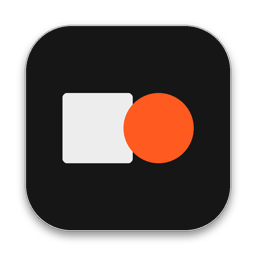
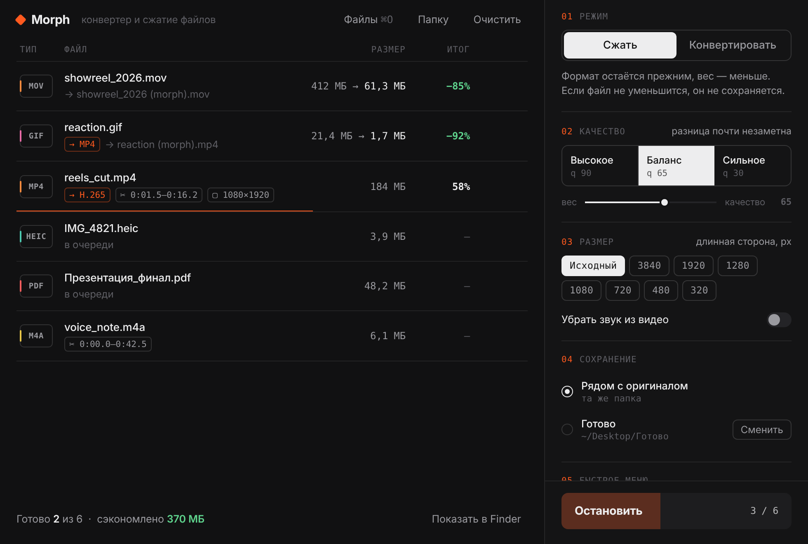
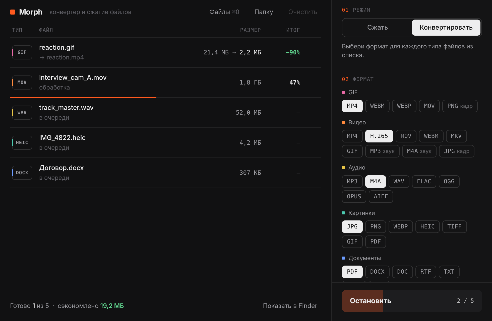

<div align="center">



# Morph

**Конвертер и сжатие любых файлов для macOS.**
Перетащил — выбрал формат — готово. Без облаков, без подписок, всё локально.

[](https://github.com/nyartny-ops/MorphConvertor/actions/workflows/ci.yml)
[](https://github.com/nyartny-ops/MorphConvertor/releases/latest)


<br>

<a href="https://github.com/nyartny-ops/MorphConvertor/releases/latest/download/Morph.dmg"></a>

<sub>бесплатно · без регистрации · работает офлайн</sub>

<br><br>



</div>

## Что умеет

| | Сжатие | Конвертация |
|---|---|---|
| **Картинки** — JPG, PNG, HEIC, WEBP, TIFF, BMP, PSD, RAW | пережатие, палитра для PNG, уменьшение размера | JPG · PNG · WEBP · HEIC · TIFF · GIF · PDF |
| **GIF** | палитра, частота кадров, размер, lossy (с gifsicle) | MP4 · WEBM · WEBP · MOV · кадр в PNG |
| **Видео** — MP4, MOV, MKV, WEBM, AVI… | H.264 / VP9 с подбором CRF, уменьшение разрешения, удаление звука | MP4 · H.265 · MOV · WEBM · MKV · GIF · MP3/M4A · кадр |
| **Аудио** — MP3, WAV, FLAC, M4A, OGG, OPUS, AIFF | пережатие с нужным битрейтом | MP3 · M4A · WAV · FLAC · OGG · OPUS · AIFF |
| **PDF** | системный фильтр macOS + растеризация для сканов | PNG/JPG по страницам · TXT · DOCX* |
| **Документы** — DOCX, DOC, RTF, TXT, HTML, ODT | — | PDF · DOCX · DOC · RTF · TXT · HTML · ODT |
| **Таблицы и слайды*** — XLSX, CSV, PPTX… | — | XLSX · CSV · ODS · PDF · PPTX · ODP |
| **Что угодно**, включая папки | ZIP | ZIP |

<sub>* через бесплатный [LibreOffice](https://www.libreoffice.org), если он установлен.</sub>

- **Оригиналы не трогаются.** Результат — рядом с исходником или в выбранной папке, с суффиксом `(morph)`, если имя занято.
- **Не делает хуже.** Если после сжатия файл не стал меньше, он не сохраняется.
- **Видно прогресс.** Для видео и аудио — реальный процент, остановка в любой момент без мусорных файлов.
- **Пачками.** Кидай сразу десятки файлов и целые папки — каждый тип получит свой формат.



## Установка

### Готовая сборка

1. Скачай [**Morph.dmg**](https://github.com/nyartny-ops/MorphConvertor/releases/latest/download/Morph.dmg) (все версии — в [Releases](https://github.com/nyartny-ops/MorphConvertor/releases)), открой и перетащи Morph в «Программы».
2. Morph не подписан сертификатом Apple, поэтому при первом запуске macOS его остановит. Один раз выполни в Терминале:

   ```bash
   xattr -dr com.apple.quarantine /Applications/Morph.app
   ```

   или «Системные настройки → Конфиденциальность и безопасность → Всё равно открыть».

ffmpeg уже внутри — для Apple Silicon и Intel.

### Из исходников

Xcode не нужен: интерфейс собирается встроенной в macOS утилитой `osacompile`.

```bash
git clone https://github.com/nyartny-ops/MorphConvertor.git
cd MorphConvertor
bash install.command
```

Установщик соберёт приложение, скачает ffmpeg под твой Mac, положит Morph в «Программы» и запустит.

## Как пользоваться

1. Перетащи файлы или папки в окно или на иконку в Dock. `⌘O` — выбрать файлы, `⇧⌘O` — папку.
2. Режим: **Сжать** (тот же формат) или **Конвертировать** — для каждого типа в списке появится свой ряд форматов.
3. Качество: «Высокое», «Баланс», «Сильное» или точнее ползунком. При необходимости — ограничить размер по длинной стороне.
4. `Enter` — старт, `Esc` — стоп. Клик по готовому файлу покажет его в Finder.

## Как это устроено

```
src/
├── main.js      окно приложения: JavaScript for Automation + Cocoa (WKWebView, очередь задач)
├── ui.html      интерфейс (HTML/CSS/JS без зависимостей)
├── convert.sh   движок: один файл → один результат (ffmpeg, sips, textutil, gifsicle, LibreOffice)
├── pdftool.js   PDF через PDFKit: сжатие, страницы в картинки, текст, документ → PDF
└── Morph.icns
scripts/build.sh собирает Morph.app (osacompile + ресурсы + ffmpeg + ad-hoc подпись)
tests/engine.sh  тесты движка на сгенерированных файлах
```

Окно общается с движком через простой протокол: `convert.sh <файл> <формат|same> <качество> <макс.сторона> <без звука> <папка>` печатает одну строку `OK / SAME / ERR`. Прогресс ffmpeg пишется в файл и читается окном.

## Разработка

```bash
bash tests/engine.sh                          # тесты движка (macOS или Linux с ffmpeg)
bash scripts/build.sh --out dist              # собрать Morph.app
bash scripts/build.sh --ffmpeg universal      # с universal ffmpeg, как в релизе
```

- **CI** на каждый push: shellcheck, проверка синтаксиса, тесты движка на Linux и macOS, сборка приложения.
- **Релиз**: поменяй номер в `VERSION` и запушь в `main` — GitHub Actions соберёт `Morph.dmg`, поставит тег и опубликует релиз.

Журнал приложения: `~/Library/Logs/Morph.log`.

## Вопросы

**«Morph повреждён» или «не удаётся проверить разработчика».** Это из-за отсутствия платной подписи Apple — см. команду `xattr` выше.

**Нет таблиц и презентаций.** Установи [LibreOffice](https://www.libreoffice.org) в «Программы» — Morph найдёт его сам.

**Хочу сжимать GIF ещё сильнее.** `brew install gifsicle` — Morph начнёт использовать его автоматически.

**Morph просит доступ к папкам.** macOS спрашивает разрешение на чтение «Загрузок», «Рабочего стола» и т. п. — без него нельзя прочитать файлы.

## Лицензия

[MIT](LICENSE). Сторонние компоненты — в [THIRD_PARTY.md](THIRD_PARTY.md).
